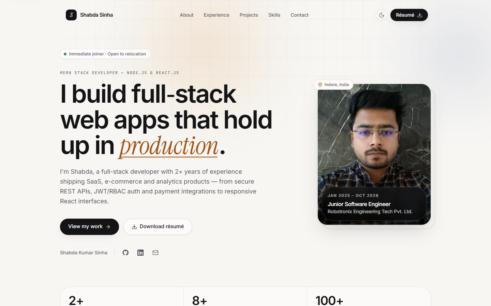
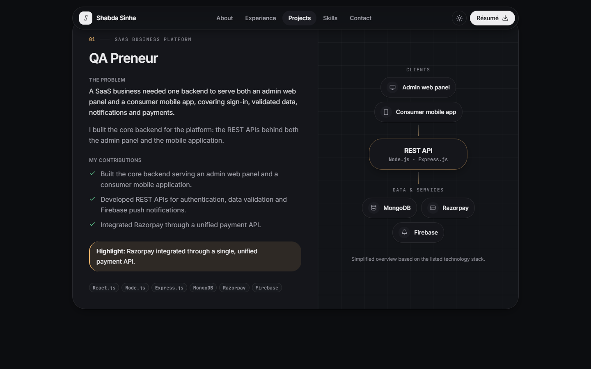
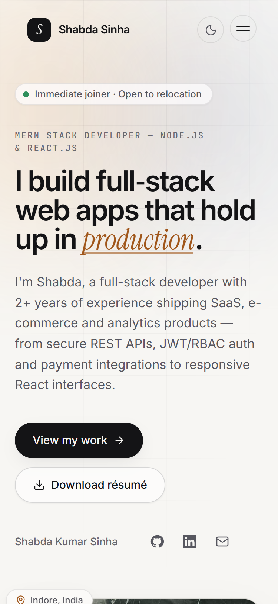

# Shabda Kumar Sinha — Developer Portfolio

Personal portfolio of **Shabda Kumar Sinha**, Full-Stack MERN Developer based in Indore, India.
A fast, accessible single-page site built with React, Vite, JavaScript, Tailwind CSS and Motion,
designed to be hosted as static files on Cloudflare Pages. There is no backend.

All professional content comes from my résumé
([`public/Shabda_Kumar_Sinha_Resume.pdf`](public/Shabda_Kumar_Sinha_Resume.pdf))
and is kept in plain data files under [`src/data/`](src/data).

## Preview



| Dark theme | Mobile |
|---|---|
|  |  |

More screenshots (desktop, tablet and mobile, both themes) are in
[`docs/screenshots/stage5`](docs/screenshots/stage5).

## Tech stack

| Area | Tools |
|---|---|
| UI | [React 19](https://react.dev), JavaScript (no TypeScript) |
| Build | [Vite 8](https://vite.dev) |
| Styling | [Tailwind CSS v4](https://tailwindcss.com) with CSS custom properties as design tokens |
| Animation | [Motion](https://motion.dev) for React (`LazyMotion` + `m` components) |
| Icons | [Lucide](https://lucide.dev), plus inline SVG brand marks |
| Fonts | Self-hosted via Fontsource: Inter, JetBrains Mono, Instrument Serif |
| Quality | ESLint 10 |
| Hosting | Static files on Cloudflare Pages |

## Key features

- **Sections:** hero, about, experience timeline, project case studies with system diagrams,
  grouped skills, education and contact.
- **Dark and light themes:** follows the system setting on the first visit, remembers the
  visitor's choice, and never flashes the wrong theme on load.
- **Responsive:** checked at 320, 375, 430, 768, 1024, 1280, 1440 and 1920 px wide.
- **Accessible:** semantic landmarks, skip link, full keyboard support, visible focus rings,
  WCAG AA colour contrast in both themes, 44 px touch targets, and an accessible mobile menu.
- **Respectful motion:** subtle scroll reveals and hover effects; pointer effects are off on
  touch screens and all movement is disabled when the system asks for reduced motion.
- **Performance:** lightweight Motion bundle, resized portrait, preloaded main font,
  metric-matched fallback font (no layout shift), and long-term caching of built assets.
- **SEO and sharing:** meta and Open Graph / X card tags, JSON-LD structured data (Person and
  WebSite), a 1200×630 social preview image, `robots.txt`, `sitemap.xml` and app icons.
- **Production hardening:** strict Content-Security-Policy and security headers, a real 404
  page, and `noindex` on preview deployments.

## Project structure

```
.
├── build/
│   └── seo-plugin.js      Build-time SEO: meta tags, JSON-LD, robots.txt, sitemap.xml, _headers
├── design/                HTML sources for the social preview image and app icons
├── docs/screenshots/      Final screenshots used in this README
├── public/                Static files copied as-is: résumé, icons, og-image, manifest, 404 page
├── src/
│   ├── assets/images/     Portrait
│   ├── components/
│   │   ├── common/        Reusable building blocks (Button, Section, Reveal, ThemeToggle…)
│   │   ├── icons/         Icon helpers
│   │   ├── layout/        Navbar, mobile menu, footer, skip link
│   │   └── sections/      One folder per page section (hero, about, experience…)
│   ├── context/           Theme provider
│   ├── data/              All site content and SEO settings
│   ├── hooks/             Scroll, theme, pointer and clipboard hooks
│   ├── styles/            Design tokens (tokens.css) and Tailwind setup (index.css)
│   ├── utils/             Small helpers (class names, motion presets, theme storage)
│   ├── App.jsx
│   └── main.jsx
├── index.html
├── vite.config.js
├── .env.example           Template for VITE_SITE_URL
└── .node-version          Node.js version used locally and on Cloudflare Pages
```

## Getting started

**Requirements:** [Node.js](https://nodejs.org) 24 (see [`.node-version`](.node-version)) and npm.

```bash
git clone https://github.com/shabdasinha1/shabda-sinha-portfolio.git
cd shabda-sinha-portfolio
npm ci
npm run dev
```

The development server runs at http://localhost:5173.

### Commands

| Command | What it does |
|---|---|
| `npm run dev` | Start the development server with hot reload |
| `npm run build` | Create the production build in `dist/` |
| `npm run preview` | Serve the production build locally at http://localhost:4173 |
| `npm run lint` | Check the code with ESLint |

### Production build

```bash
npm run build
npm run preview
```

`dist/` contains everything needed for static hosting, including the generated
`robots.txt`, `_headers` (Cloudflare Pages headers) and, when the site URL is set,
`sitemap.xml`.

## Environment variables

| Variable | Required | Purpose |
|---|---|---|
| `VITE_SITE_URL` | For production | The public address of the site, e.g. `https://example.com` (no trailing slash). Read at **build time**. |

Some tags need the site's full address: the canonical URL, `og:url`, `og:image`,
`twitter:image` and `sitemap.xml`. The address is never hard-coded.

- **Not set:** the build prints a warning and leaves those tags and the sitemap out.
  Everything else is still generated. Social previews show text without the image.
- **Set:** all of the above are added automatically.

For a local build, copy [`.env.example`](.env.example) to `.env` and fill it in.
`.env` files are git-ignored.

## Deploying to Cloudflare Pages

1. In the Cloudflare dashboard, open **Workers & Pages → Create → Pages → Connect to Git**
   and select this repository.
2. Build settings:
   - Framework preset: **None** (or Vite)
   - Build command: `npm run build`
   - Build output directory: `dist`
   - The Node.js version is read from `.node-version`.
3. Deploy once. The site is then available at `https://<project>.pages.dev`.
4. Set the site address:
   - **Using the free address:** set `VITE_SITE_URL` to `https://<project>.pages.dev`.
   - **Using a custom domain:** add it under **Custom domains**, wait until it is active,
     then set `VITE_SITE_URL` to `https://<your-domain>`.

   Add the variable under **Settings → Environment variables → Production** only
   (leave Preview empty), then **redeploy** so the build picks it up.
5. After deploying, check the result with:
   - [Google Rich Results Test](https://search.google.com/test/rich-results) (structured data)
   - [LinkedIn Post Inspector](https://www.linkedin.com/post-inspector/) and
     [Facebook Sharing Debugger](https://developers.facebook.com/tools/debug/) (social previews)
   - Google Search Console: add the site and submit `/sitemap.xml`.

### What the build generates for Cloudflare

| File | Purpose |
|---|---|
| `dist/_headers` | Security headers for every page, one-year caching for `/assets/*`, and `noindex` for preview deployments (`<hash>.<project>.pages.dev`). With a custom domain it also marks the duplicate `<project>.pages.dev` address `noindex`. |
| `dist/robots.txt` | Allows all crawlers; points to the sitemap when the site URL is set. |
| `dist/sitemap.xml` | Generated only when `VITE_SITE_URL` is set. |
| `public/404.html` | A real 404 page. Without it, Pages returns the homepage with status 200 for every unknown URL. |

### Security headers

Defined in [`build/seo-plugin.js`](build/seo-plugin.js) (`headersFile()`).

- **Content-Security-Policy** allows only the site's own files. The single inline script
  (theme setup in `index.html`) is allowed by its exact SHA-256 hash, recalculated on every
  build. Fonts are never inlined as `data:` URLs, so `font-src 'self'` stays strict.
  **If you add third-party scripts later** (for example Cloudflare Web Analytics), add their
  domains to `script-src` / `connect-src` there, or they will be blocked.
- **X-Frame-Options: DENY** and `frame-ancestors 'none'` stop other sites from framing the page.
- **Strict-Transport-Security**: one year, without `includeSubDomains` or `preload`.
- **Permissions-Policy** disables camera, microphone, location, payment and USB.
- **Referrer-Policy** `strict-origin-when-cross-origin`, **X-Content-Type-Options** `nosniff`,
  **Cross-Origin-Opener-Policy** `same-origin`.

## Editing content

| To change… | Edit |
|---|---|
| Name, role, hero text, résumé file | [`src/data/profile.js`](src/data/profile.js) |
| About, experience, projects, skills, education, contact | the matching file in [`src/data/`](src/data) |
| Social links | [`src/data/socials.js`](src/data/socials.js) |
| Page title, description, structured data | [`src/data/seo.js`](src/data/seo.js) |
| Colours, shadows, spacing tokens | [`src/styles/tokens.css`](src/styles/tokens.css) |

### Regenerating brand images

`public/og-image.jpg` (1200×630) and the app icons are rendered from
[`design/og-image.html`](design/og-image.html) and [`design/icon.html`](design/icon.html),
which use the site's own fonts, colours and portrait. After editing a template, open it in
Chrome and capture it at its exact size (DevTools → device toolbar → set the size →
"Capture screenshot"). The icon template takes `?size=512&variant=rounded|square|maskable`.

## License

No open-source license has been chosen yet, so all rights are reserved. The résumé, portrait
and personal content are not licensed for reuse.
