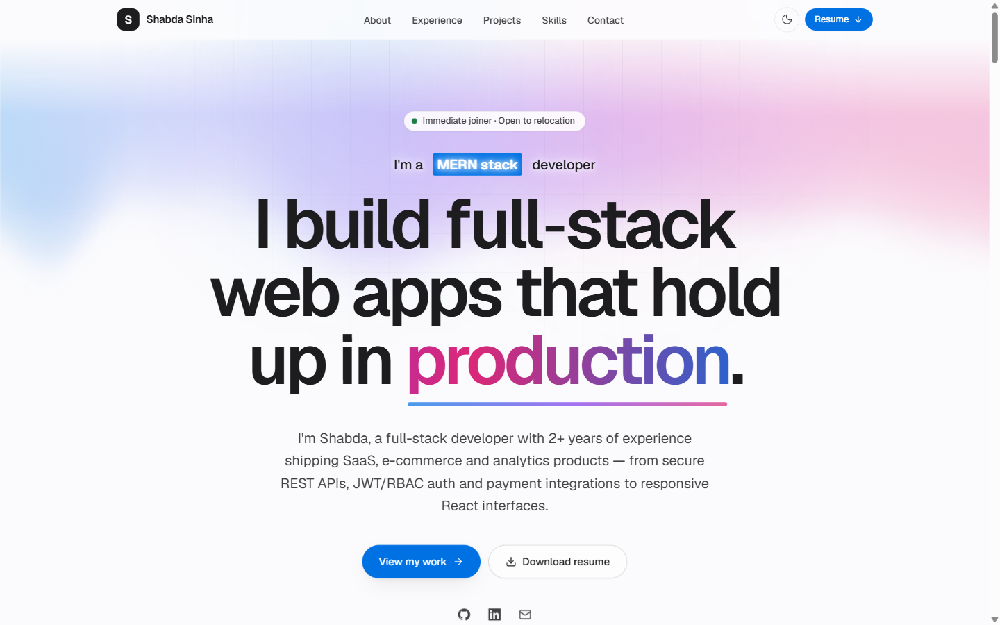
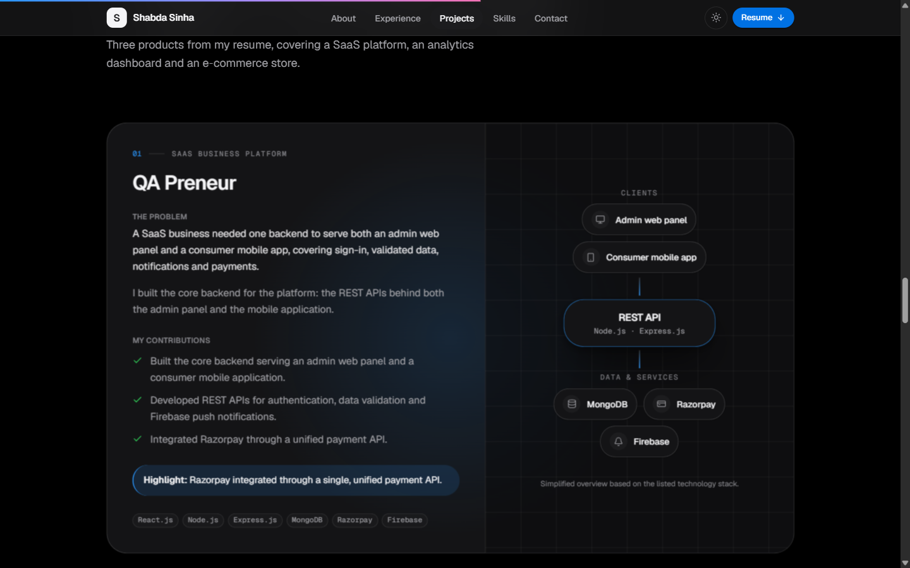
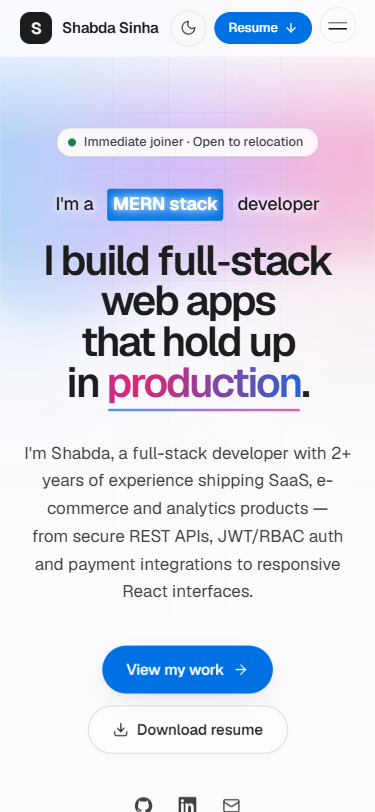

# Shabda Kumar Sinha — Developer Portfolio

Personal portfolio of **Shabda Kumar Sinha**, Full-Stack MERN Developer based in Indore, India.
A fast, accessible single-page site built with React, Vite, JavaScript, Tailwind CSS, Motion,
[React Bits](https://reactbits.dev) and Three.js,
deployed as static files to GitHub Pages with GitHub Actions. There is no backend.

All professional content comes from my résumé
([`public/Shabda_Kumar_Sinha_Resume.pdf`](public/Shabda_Kumar_Sinha_Resume.pdf))
and is kept in plain data files under [`src/data/`](src/data).

## Preview



| Dark theme | Mobile |
|---|---|
|  |  |

More screenshots (desktop, tablet and mobile, both themes) are in
[`docs/screenshots/current`](docs/screenshots/current).

## Tech stack

| Area | Tools |
|---|---|
| UI | [React 19](https://react.dev), JavaScript (no TypeScript) |
| Build | [Vite 8](https://vite.dev) |
| Styling | [Tailwind CSS v4](https://tailwindcss.com) with CSS custom properties as design tokens |
| Animation | [Motion](https://motion.dev) for React: scroll-linked effects, spring-smoothed reveals and 3D tilt (`LazyMotion` + `m` components) |
| Components | [React Bits](https://reactbits.dev) (vendored and adapted, see [Credits](#credits)) |
| 3D / WebGL | [Three.js](https://threejs.org) for the hero ID badge; raw WebGL2 for the aurora and the ball pit |
| Icons | [Lucide](https://lucide.dev), plus inline SVG brand marks |
| Fonts | Self-hosted via Fontsource: [Geist and Geist Mono](https://vercel.com/font) |
| Quality | ESLint 10 |
| Hosting | GitHub Pages, deployed by GitHub Actions |

## Key features

- **Sections:** hero, about, experience timeline, project case studies with system diagrams,
  grouped skills, education and contact.
- **Dark and light themes:** follows the system setting on the first visit, remembers the
  visitor's choice, and never flashes the wrong theme on load.
- **Responsive:** checked at 320, 375, 430, 768, 1024, 1280, 1440 and 1920 px wide.
- **Accessible:** semantic landmarks, skip link, full keyboard support, visible focus rings,
  WCAG AA colour contrast in both themes (measured on the rendered pixels, including over the
  aurora), touch targets of at least 24 px, and an accessible mobile menu. Decorative 3D and
  WebGL effects are hidden from screen readers.
- **3D and interactive extras (React Bits):** a Three.js ID badge on a lanyard that you can
  grab and fling, a WebGL aurora behind the hero, a "full-stack / MERN stack" rotating title,
  gradient headline text, magnetic buttons, cursor-lit cards, a scroll-driven tech marquee,
  blur-in section titles, click sparks and a ball-pit playground in the contact section.
- **Apple-style motion:** a hero that recedes as you scroll, a portrait showcase that tilts up
  into place, a statement whose words light up as you read, a timeline that fills with scroll,
  count-up numbers, blur-in reveals and a scroll-progress line. All scroll effects are
  spring-smoothed; pointer effects are off on touch screens, and every movement is disabled
  when the system asks for reduced motion.
- **Performance:** lightweight Motion bundle, resized portrait, preloaded main font,
  metric-matched fallback font (no layout shift), and long-term caching of built assets.
  The heavy effects never block the first paint: the Three.js badge (~140 KB gzipped) is a
  separate chunk loaded only after the page has settled, the aurora starts after the hero
  entrance, and the ball pit loads only when the contact section is near. Without WebGL2 the
  portrait and CSS backgrounds are shown instead.
- **SEO and sharing:** meta and Open Graph / X card tags, JSON-LD structured data (Person and
  WebSite), a 1200×630 social preview image, `robots.txt`, `sitemap.xml` and app icons.
- **Production hardening:** strict hash-based Content-Security-Policy, referrer policy, and a
  real 404 page.

## Project structure

```
.
├── build/
│   └── seo-plugin.js      Build-time SEO: meta tags, CSP, JSON-LD, 404.html, robots.txt, sitemap.xml
├── design/                HTML sources for the social preview image, app icons and badge textures
├── .github/workflows/     deploy.yml: lint, build and publish to GitHub Pages
├── docs/screenshots/      Final screenshots used in this README
├── public/                Static files copied as-is: résumé, icons, og-image, manifest, 404 styles
├── src/
│   ├── assets/images/     Portrait and the two badge textures (front and back)
│   ├── components/
│   │   ├── common/        Reusable building blocks (Button, Section, Reveal, ThemeToggle…)
│   │   ├── icons/         Icon helpers
│   │   ├── layout/        Navbar, mobile menu, footer, skip link
│   │   ├── reactbits/     Vendored React Bits components (adapted; see Credits)
│   │   └── sections/      One folder per page section (hero, about, experience…)
│   ├── context/           Theme provider
│   ├── data/              All site content and SEO settings
│   ├── hooks/             Scroll, theme, pointer and clipboard hooks
│   ├── styles/            Design tokens (tokens.css) and Tailwind setup (index.css)
│   ├── utils/             Small helpers (class names, motion presets, brand colours, theme storage, deferred start)
│   ├── App.jsx
│   └── main.jsx
├── index.html
├── vite.config.js
├── .env.example           Template for VITE_SITE_URL
└── .node-version          Node.js version used locally and by the deploy workflow
```

## Getting started

**Requirements:** [Node.js](https://nodejs.org) 24 (see [`.node-version`](.node-version)) and npm.

```bash
git clone https://github.com/shabdasinha1/shabda-sinha-portfolio.git
cd shabda-sinha-portfolio
npm ci
npm run dev
```

The development server runs at http://localhost:5173.

### Commands

| Command | What it does |
|---|---|
| `npm run dev` | Start the development server with hot reload |
| `npm run build` | Create the production build in `dist/` |
| `npm run preview` | Serve the production build locally at http://localhost:4173 |
| `npm run lint` | Check the code with ESLint |

### Production build

```bash
npm run build
npm run preview
```

`dist/` contains everything needed for static hosting, including the generated `404.html`,
`robots.txt` and, when the site URL is set, `sitemap.xml`.

To reproduce the exact GitHub Pages build locally (served under the same sub-path):

```bash
VITE_SITE_URL=https://shabdasinha1.github.io/shabda-sinha-portfolio npm run build
VITE_SITE_URL=https://shabdasinha1.github.io/shabda-sinha-portfolio npm run preview
```

Then open http://localhost:4173/shabda-sinha-portfolio/.

## Environment variables

| Variable | Required | Purpose |
|---|---|---|
| `VITE_SITE_URL` | Set by the deploy workflow | The public address of the site, without a trailing slash. Read at **build time**. |

`VITE_SITE_URL` controls two things:

- **The base path** the site is served from, taken from the URL's path. A GitHub Pages
  project site lives under `/<repository>/`, so every CSS, JavaScript, image, font and icon
  URL is built with that prefix.
- **Absolute URLs** for the canonical link, `og:url`, `og:image`, `twitter:image`,
  structured data and `sitemap.xml`.

You normally never set it by hand: the workflow reads the real Pages URL from GitHub
(`actions/configure-pages`) and passes it to the build. Without it, a build uses base `/` and
leaves the URL-dependent tags and the sitemap out (with a warning), which is what
`npm run dev` and plain local builds use. See [`.env.example`](.env.example).

## Deployment (GitHub Pages)

Every push to `main` deploys automatically through
[`.github/workflows/deploy.yml`](.github/workflows/deploy.yml). It can also be started by hand
from the **Actions** tab (**Deploy to GitHub Pages → Run workflow**).

| Job | Steps |
|---|---|
| **Lint and build** | checkout → Node.js from `.node-version` (npm cache) → read Pages configuration → `npm ci` → `npm run lint` → `npm run build` → upload `dist/` as the Pages artifact |
| **Deploy** | publish the artifact with `actions/deploy-pages` (runs only if the build job succeeds) |

- **Permissions:** the build job can only read the repository; only the deploy job gets
  `pages: write` and `id-token: write`.
- **Concurrency:** deployments run one at a time; a newer push waits instead of cancelling a
  deployment in progress.
- **Build output:** `dist/` is never committed; it is built fresh in CI.

### One-time repository setting

**Repository → Settings → Pages → Build and deployment → Source: GitHub Actions.**
(No branch needs to be selected.)

### Routing and 404s

The site is a single page whose navigation uses `#section` anchors, so no SPA routing fallback
is needed: the homepage and links such as `…/#projects` load directly (the app scrolls to the
section once it has rendered). Any other path returns GitHub Pages' 404 status with the
site's own `404.html`.

### Security on GitHub Pages

GitHub Pages does not allow custom HTTP response headers, so the policies are delivered in the
HTML instead (see [`build/seo-plugin.js`](build/seo-plugin.js)):

- **Content-Security-Policy** (`<meta>`): only the site's own files may load. The single inline
  script (theme setup in `index.html`) is allowed by its exact SHA-256 hash, recalculated on
  every build. Fonts are never inlined as `data:` URLs, so `font-src 'self'` stays strict.
  **If you add third-party scripts later**, add their domains to `script-src` / `connect-src`
  there, or they will be blocked.
- **Referrer-Policy** (`<meta>`): `strict-origin-when-cross-origin`.
- **HTTPS** is enforced by GitHub Pages.
- Header-only protections (`X-Frame-Options` / `frame-ancestors`, `Permissions-Policy`,
  `X-Content-Type-Options`) cannot be set on GitHub Pages; browsers ignore them in `<meta>`.

### Search engines

- `sitemap.xml` is published with the site; submit it in Google Search Console after adding
  the site as a property.
- Crawlers only read `robots.txt` at the root of a host. For a project site that is
  `https://<owner>.github.io/robots.txt`, outside this repository, so the generated
  `robots.txt` takes effect only if the site later moves to a custom domain. Without one,
  crawlers treat the site as allowed, which is the intended behaviour.
- After deploying, check the result with the
  [Google Rich Results Test](https://search.google.com/test/rich-results) (structured data) and
  [LinkedIn Post Inspector](https://www.linkedin.com/post-inspector/) /
  [Facebook Sharing Debugger](https://developers.facebook.com/tools/debug/) (social previews).

## Editing content

| To change… | Edit |
|---|---|
| Name, role, hero text, résumé file | [`src/data/profile.js`](src/data/profile.js) |
| About, experience, projects, skills, education, contact | the matching file in [`src/data/`](src/data) |
| Social links | [`src/data/socials.js`](src/data/socials.js) |
| Page title, description, structured data | [`src/data/seo.js`](src/data/seo.js) |
| Colours, shadows, spacing tokens | [`src/styles/tokens.css`](src/styles/tokens.css) |

### Regenerating brand images

`public/og-image.jpg` (1200×630) and the app icons are rendered from
[`design/og-image.html`](design/og-image.html) and [`design/icon.html`](design/icon.html),
which use the site's own fonts, colours and portrait. After editing a template, open it in
Chrome and capture it at its exact size (DevTools → device toolbar → set the size →
"Capture screenshot"). The icon template takes `?size=512&variant=rounded|square|maskable`.

The 3D badge textures `src/assets/images/badge-front.jpg` and `badge-back.jpg` come from
[`design/badge.html`](design/badge.html) (`?side=front|back`, 640×900; capture at 1.5× and
save as JPEG).

## Credits

Several interactive components are adapted from [React Bits](https://reactbits.dev) by David Haz,
copied into [`src/components/reactbits/`](src/components/reactbits) so they can be tuned for
this site (for example: `m` components for `LazyMotion`, reduced-motion support, and
accessibility fixes). Each file notes its source and the local changes. React Bits is licensed
under MIT + Commons Clause; see [`src/components/reactbits/LICENSE.md`](src/components/reactbits/LICENSE.md).

## License

No open-source license has been chosen yet, so all rights are reserved. The résumé, portrait
and personal content are not licensed for reuse.
